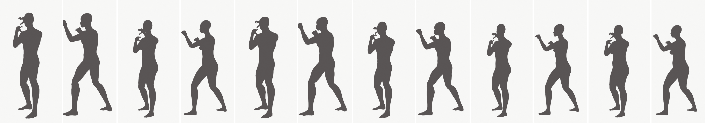

# Characters

Game-ready fighters, each made from its portrait in [`3d/`](../3d/). A portrait is one skinned body in a pose with everything else frozen round it; a fighter is every part skinned, in the rest pose, on a game skeleton, with image textures.

| Character | Blender model | FBX | From |
|---|---|---|---|
| [Ògún](ogun/) | `ogun/SK_Ogun.blend` | `ogun/Export/` | `3d/ogun/ogun.blend` |

Ògún is the pilot: the first figure taken the whole way, to find out what the way is. His folder holds the model, the FBX files, the textures, preview renders and the script that makes them all from the portrait. Its README lists what was built, what was measured, and what is approximate.

## How a portrait becomes a fighter

[`gamekit.py`](gamekit.py) holds the steps any figure needs, and each character's build script holds what is its alone.

1. **Body.** The figure's own shape from MPFB, on the skeleton every fighter shares: the 53 bones of MPFB's `game_engine` rig, named as Unreal's mannequin names them, with a root on the ground and a weapon bone in each hand. The mesh is vertex for vertex the portrait's.
2. **Back to the rest pose.** Each thing the portrait wears takes the skinning transform of the skin nearest it and has it undone. Cloth goes back point by point; a bangle or a link of chain goes back in one piece.
3. **Light versions.** Cloth is thinned, strips become ribbons, chains and rings are rebuilt from a few of their own points, hair becomes a thin layer over shaded skin.
4. **Textures.** The portrait's node materials are baked to colour, normal and a packed occlusion, roughness and metal map, or painted to match where a bake cannot follow.
5. **Skin weights.** Everything worn takes its weights from the nearest skin; rigid things take one set for the whole piece.
6. **Export and check.** FBX in centimetres, read back into an empty scene and counted.

The pilot's stances and its one clip are there to try the rig, not as the game's animation.

## Sharing movement

A clip made for one fighter is meant to play on all of them. In Unreal that means one Skeleton asset for every fighter, and it works only if their skeletons are the same in three ways. [`gamekit.game_body`](gamekit.py) sees to all three, so a fighter built with it needs nothing more.

- **The same bones.** 55 in the same order of parents: MPFB's 53, and `weapon_r` and `weapon_l`, which every fighter has whether it holds anything or not.
- **The same rest frames.** [`skeleton.json`](skeleton.json) holds the way each bone is turned at rest, taken from Ògún. Each fighter's joints stay where its own body has them and its bones are turned to these frames. MPFB fits its rig to each body, and the fit alone does not give this: the toe bones of the three women's rigs lie 84° to 93° round from Ògún's, and the bones of their spines lean 9° to 19° otherwise. Played on those rigs as fitted, Ògún's guard curled the toes under and put the feet up to 19 mm through the floor.
- **The same grip.** Each weapon bone sits at the same place in the hand, in hand lengths, turned the same way. A weapon made with its grip at its own origin sits alike in any hand.

### What was tried

[`check_shared_motion.py`](check_shared_motion.py) makes the bare game body of each figure in `3d/`, poses it as an engine will when it plays Ògún's `A_Ogun_GuardIdle`, and measures it at 13 frames of the clip. Every bone takes the clip's turn and keeps its own length. The results are in [`shared_motion.json`](shared_motion.json).

Left to right: Ekwensu, Idemili, Ògún, Ọ̀ṣọ́ọ̀sì, Ọ̀ṣun, Yemọja.

| Figure | Height | Lowest point, hips in proportion | Hips as the clip has them | Hips left at rest | Forearm or hand inside the body |
|---|---:|---:|---:|---:|---:|
| Ekwensu | 1.884 m | −0.4 mm | −35.3 mm | +77.5 mm | none |
| Idemili | 1.745 m | −1.4 mm | +61.1 mm | +68.2 mm | none |
| Ògún | 1.810 m | 0.0 mm | 0.0 mm | +75.0 mm | none |
| Ọ̀ṣọ́ọ̀sì | 1.716 m | +0.7 mm | +64.0 mm | +70.5 mm | none |
| Ọ̀ṣun | 1.672 m | −1.0 mm | +102.7 mm | +65.2 mm | none |
| Yemọja | 1.652 m | −0.6 mm | +110.1 mm | +64.9 mm | none |

The lowest point is the sole of a foot against the floor at zero: below zero is in the floor, above is in the air. The three columns are the three ways an engine can move the hips, and only the first keeps the feet down. The feet do not move in this clip, on any figure.

The two stances in `gamekit.py` are written in Ògún's measurements and brought to the size of whichever figure they are run on. Run on Ekwensu, the tallest, and Yemọja, the shortest, the guard puts the soles within 1.3 mm of the floor and the lead hand at the same share of the figure's height, to within a quarter of a percent. In the kick Yemọja's standing leg is at its full length and her sole is 2.9 mm off the floor.

### In Unreal (not tested)

1. Import the first fighter with a new skeleton. Import every other with that Skeleton asset chosen, not a new one.
2. In the Skeleton's bone tree, set Translation Retargeting to **Skeleton** on every bone, then **Animation** on `root` and **Animation Scaled** on `pelvis`. These are the settings of the first column of the table.
3. Any clip imported on that Skeleton then plays on every fighter.

### What this does not cover

- **One clip, with still feet.** A clip that steps will carry each fighter Ògún's distance in proportion to its hips, and feet can slide on a body whose legs are a different share of its height. Foot IK in the engine is the usual cure.
- **Bare bodies.** No other fighter has clothes yet. A hand that clears a body may still pass through a wrapper, which stands out from it.
- **What is held.** Ògún's guard closes both hands as fists. A fighter with a bow, or with open hands, needs its own arms over the shared legs and trunk.
- **What hangs.** A fringe, a wrapper or long hair moves with the bones it is weighted to and no more.

## Rebuilding

Install Blender 4.5 and [MPFB2](https://github.com/makehumancommunity/mpfb2) as a Blender extension, as for `3d/`. Run a character's commands from the repo root; they are in its README. The check of shared movement is `blender -b --factory-startup --python characters/check_shared_motion.py`, and takes about two minutes. Set `GAME_WORK` to a scratch folder for the stages in between. If it isn't set, each character uses a `work/` folder beside its script, which git ignores.
