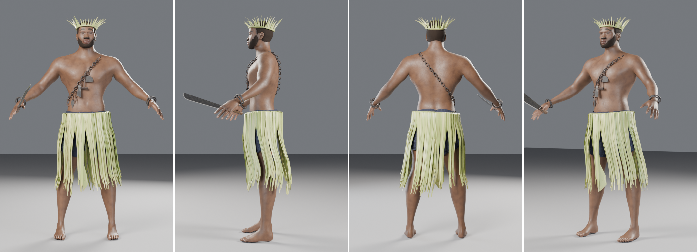
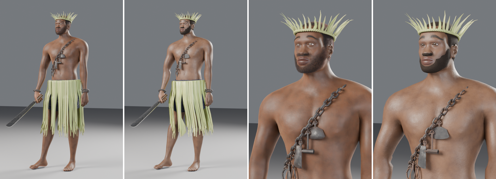

# Ògún (game character)

Ògún as a fighter: one skinned mesh of 45,455 triangles on the 55-bone skeleton every fighter shares, five materials on image textures, his àdá as a mesh of its own, and one test clip. He is made from the portrait in [`3d/ogun/`](../../3d/ogun/) by the script in this folder, so the two stay the same man.

He is the pilot for the other figures. **Nothing here has been opened in Unreal yet.** Every check below was made in Blender; [In Unreal](#in-unreal-not-tested) says what to do there and what to look at first.



## Files

| File | What it is |
|---|---|
| `SK_Ogun.blend` | The character, saved with Blender 4.5 LTS: the armature `Armature`, the mesh `SK_Ogun`, the àdá `SM_Ogun_Ada` held by the bone `weapon_r`, and the clip `A_Ogun_GuardIdle`. Textures load from `Textures/` by relative path. |
| `Export/SK_Ogun.fbx` | The skeletal mesh: centimetres, triangles, tangents, no leaf bones. 4.4 MB. |
| `Export/SM_Ogun_Ada.fbx` | The àdá alone: grip at the origin, blade along +Z, cutting edge toward −Y. |
| `Export/A_Ogun_GuardIdle.fbx` | The clip on the skeleton alone: 61 frames at 30 a second. |
| `Export/check.json` | What Blender finds when it reads each FBX back into an empty scene. |
| `Textures/` | 18 PNG maps, 11 MB: base colour, normal (OpenGL, green up) and a packed map (occlusion in red, roughness in green, metal in blue) for each of six materials. |
| `Renders/` | [Views](Renders/Ogun_Views.png), [the wire](Renders/Ogun_Wire.png), [the rig in three poses](Renders/Ogun_Poses.png), and [the portrait beside the game model](Renders/Ogun_Compare.png). |
| `build_ogun_game.py` | The script that makes all of the above from `3d/ogun/ogun.blend`. The steps any figure needs are in [`../gamekit.py`](../gamekit.py). |

## Against the portrait



In each pair the portrait is on the left. The game model is standing in the portrait's pose, which was carried across from the portrait's 163-bone rig to the game rig.

| | Portrait (`3d/ogun/ogun.blend`) | Game (`SK_Ogun`) |
|---|---|---|
| Triangles in the figure | 295,836, and 808,156 as Blender exports it | 45,455 |
| Meshes | 14, one of them skinned | 1, all of it skinned |
| Hair | 102,183 curves, which FBX drops | A layer over shaded skin, and brows drawn into the skin's colour |
| Skeleton | 163 bones, the root at the hips | 53 bones and a weapon bone in each hand, the root on the ground |
| Materials | 12, of which 5 are procedural and 5 are not a plain Principled surface | 5, and 1 for the àdá, all on image maps |
| Materials that keep a texture through FBX | 1 | 6 |
| FBX | 20.9 MB, with his dog and àdá | 4.4 MB, and 0.06 MB for the àdá |

## What was built

45,455 triangles and 26,773 vertices, against a budget of 60 to 100 thousand triangles for a fighter.

| Part | Triangles | Material | How it was made |
|---|---:|---|---|
| Body | 26,002 | Skin | MPFB's mesh, vertex for vertex the portrait's, less the 377 faces the trousers hide |
| Hair cap, beard | 836 / 1,140 | Hair | A layer 4 mm off the scalp and 4.5 mm off the jaw, where the portrait grows 99,419 curves. It covers only the thick of the hair; the thin edge is shading on the skin |
| Eyes | 252 each | Gear | The toolkit's eyeball, which has 6,016 in the portrait |
| Ṣòkòtò | 3,199 | Etu | The portrait's simulated cloth, thinned from 27,188 |
| Màrìwò fringe | 5,600 | Mariwo | All 280 of the portrait's strips, each a flat ribbon of ten quads. The portrait's fringe is 152,320 |
| Waist cord, head cord | 576 / 384 | Gear | One rope along the line between the portrait's two plies |
| Head fronds | 400 | Mariwo | The 40 leaflet ends, five quads each |
| Chain | 3,600 | Gear | All 45 links, each rebuilt from ten points of its rod with a square section |
| Tools on the chain | 2,014 | Gear | The six small tools and the rings that carry them, thinned by half |
| Bangles | 240 each | Gear | The toolkit's ring, which has 2,688 in the portrait: three on the left wrist and two on the right |
| **Àdá** (its own mesh) | 616 | Ada | Blade, handle, ferrule and rivets from a few of the portrait's own stations. The portrait's is 14,616 |

**Skeleton.** MPFB's `game_engine` rig: `root` on the ground at the origin, then `pelvis`, `spine_01` to `spine_03`, `neck_01`, `head`, and on each side `clavicle`, `upperarm`, `lowerarm`, `hand`, three bones to a finger, `thigh`, `calf`, `foot` and `ball`. The names are the ones Unreal's mannequin uses. The rest pose is MakeHuman's, with the arms 48° below level. There are no face bones, so the jaw and eyes do not move.

**Weapon bones.** `weapon_r` and `weapon_l` are children of the hands with no weights. Every fighter has both, in the same place in the hand, so that all of them have the same 55 bones and a thing made for one hand sits alike in any other; see [Sharing movement](../README.md#sharing-movement). The place was measured from this figure: the head of `weapon_r` is the middle of the àdá's grip, it points along the blade, and its Z axis points to the cutting edge. In `SK_Ogun.blend` the àdá is parented to it. `weapon_l` is its mirror and holds nothing.

**Weights.** Every vertex has one to four weights that sum to one.
- The body has MPFB's weights for this rig, cut to four on the 608 vertices that had five or six.
- Hair takes the weights of the skin it stands on.
- The trousers and the waist cord take the weights of the nearest skin of the hips and legs.
- Each strip of the fringe takes its weights from the hips and thighs, and keeps to the hips more the lower it hangs, so a raised thigh lifts it without carrying it out straight.
- Each link and each tool moves in one piece, on two bones at most.
- The bangles ride the forearms. The eyes and the headband ride the head.

**Materials and texture coordinates.** One `UVMap`.

| Material | Maps | Size | How the mesh uses them |
|---|---|---|---|
| `M_Ogun_Skin` | `T_Ogun_Skin_*` | 2048 | MakeHuman's layout, nothing overlapping |
| `M_Ogun_Gear` | `T_Ogun_Gear_*` | 1024 | An atlas. The 45 links share one patch, the 5 bangles another and the 2 eyes a third |
| `M_Ogun_Etu` | `T_Ogun_Etu_*` | 512 | Repeats: one unit is one strip of the cloth across (10.5 cm) and four picks along (10.1 cm). Two-sided |
| `M_Ogun_Mariwo` | `T_Ogun_Mariwo_*` | 1024 | Sixteen leaflets side by side, eight tints with and without a midrib. Each ribbon is drawn from one, its cut end at the bottom. Two-sided |
| `M_Ogun_Hair` | `T_Ogun_Hair_*` | 512 | Repeats |
| `M_Ogun_Ada` | `T_Ogun_Ada_*` | 1024 × 512 | An atlas. The four rivets share one patch |

The packed maps of `Etu` and `Hair` are 4 × 4, because their roughness is one value. Two values the maps do not carry are set on the Blender materials: the skin's specular level is 0.36, the portrait's own, and the hair's is 0.15.

**Conventions.** 1 unit = 1 m in the `.blend`, +Z up, facing −Y, feet at Z = 0, every transform at identity. The FBX files are in centimetres with a scale of one on the armature.

## How the textures were made

- **Skin, iron, eyes and the àdá** are baked in Cycles from the portrait's own node materials: base colour, roughness and metal by wiring each to an emitter for the bake, and the normal from the material's bump. The skin's occlusion is the body's shadow on itself alone.
- **Brows and the lash line** are the portrait's hair curves, drawn into the skin's colour where the skin under each is drawn.
- **Fronds** are baked from the portrait's palm material on sixteen flat leaflets at their true size.
- **Ẹ̀tù** is one strip of the portrait's cloth maps, four picks long, cut so that it repeats.
- **Hair and the cords** are painted by the script to match the portrait.

Three things were changed by eye against the portrait in the same light:
- The skin's colour is 10% deeper, to stand in for the light the portrait's skin scatters under its surface.
- The bake rusted every hollow between the light chain links, so 70% of that rust is taken back to black scale.
- A frond's colour holds 8% of the colour of the light that comes through it.

## What is approximate

- **Hair** is a cap and a layer, not strands. It reads right at a fighting camera's distance and plain in a close-up.
- **The fringe has no motion of its own.** It follows the hips and thighs. In [the pose sheet](Renders/Ogun_Poses.png) it drapes over the raised thigh in the kick but does not swing, and in the guard it parts at the forward hip so that the trousers show. Cloth simulation or a few skirt bones in the engine would give it its own movement.
- **The trousers** are one layer of cloth, drawn two-sided.
- **Skin** is a plain surface. The portrait's scatters light beneath it.
- **The clip and the stances** are there to try the rig. They are not the game's animation. The clip has been played on the bare bodies of the other five figures, in Blender, as an engine plays it on a shared skeleton: see [Sharing movement](../README.md#sharing-movement). No retargeting from another skeleton, such as Unreal's mannequin, has been tried.
- **There are no LODs, no physics asset and no collision.**
- **His dog** is not here. It would be a character of its own.

## In Unreal (not tested)

1. Import `Export/SK_Ogun.fbx` as a skeletal mesh with a new skeleton. Leave Import Uniform Scale at 1. He should stand 181 cm to the top of his head and 185 cm to the tips of the fronds, with one root bone called `root`.
2. On the mesh, turn on **Use Full Precision UVs**. The cloth and hair maps repeat across coordinates from −5 to 7, which half-precision coordinates would blur.
3. Import the 18 textures. Base colour: sRGB on. Normal: tick **Flip Green Channel**, since these are OpenGL maps, as the locations' are. Packed map: sRGB off, compression Masks; red is occlusion, green roughness, blue metal.
4. Make one parent material with those three maps and an instance for each of the six. Set Two Sided on `Etu` and `Mariwo`. Set Specular to 0.36 on `Skin` and 0.15 on `Hair`.
5. Import `Export/SM_Ogun_Ada.fbx` as a static mesh and attach it to the bone `weapon_r`. If the blade points the wrong way, turn the attachment: the bone's axes were set in Blender and Unreal names bone axes differently.
6. Import `Export/A_Ogun_GuardIdle.fbx` as an animation on the skeleton from step 1. That Skeleton asset is the one every later fighter should be imported onto; [Sharing movement](../README.md#sharing-movement) has the settings.
7. Let Unreal make two LODs, at about 50% and 25%.

Look first at the scale and the root bone, then at the àdá in the hand, then at the tiled cloth.

## Found on the way

- **The portrait's chain holds 36 vertices with no position** (NaN), six on each ring that carries a tool. `sweep_ring` in [`3d/ogun/blender/iron.py`](../../3d/ogun/blender/iron.py) repeats the ring's end point, so the last section has no direction to stand across. The build here takes those vertices out as it reads the chain; the portrait itself is unchanged.
- **The toolkit's ring is wound inside out**, which the bangles here correct. The portrait's bangles are unchanged.

## Rebuild

Install Blender 4.5 and [MPFB2](https://github.com/makehumancommunity/mpfb2) as a Blender extension, set `GAME_WORK` to a scratch folder, and run these from the repo root. The first takes about four minutes on an 8 GB Apple M1, most of it the skin's bake:

```bash
blender -b --python characters/ogun/build_ogun_game.py -- body source parts textures assemble animate export
```

The renders take about five minutes more. `portrait` renders the portrait's own figure for the comparison:

```bash
blender -b --python characters/ogun/build_ogun_game.py -- portrait renders
```

The stages and their options are listed at the top of the script.

## Checks

All made in Blender 4.5.15 LTS.

- **Rest pose:** the body's vertices are the portrait's to within 0.01 mm, and the skinning transforms worked out for the carry-back give the portrait's posed skin to within 0.0003 mm of Blender's own.
- **Mesh:** no n-gons, no loose vertices, no edge with three faces, no flipped neighbours, no zero-area faces, and no face without area in the texture map.
- **Weights:** no vertex without weights, four at most on any vertex, all summing to one. 52 bones carry weight; `root` and the two weapon bones carry none.
- **FBX read back:** `SK_Ogun.fbx` gives one armature of 55 bones with the single root `root`, and one skinned mesh of 45,455 triangles, 1.227 × 0.605 × 1.846 m, its lowest point at 0. Colour and normal maps are found for all five materials. `SM_Ogun_Ada.fbx` gives one mesh of 616 triangles, 57.9 cm long. `A_Ogun_GuardIdle.fbx` gives the armature and 61 frames.
- **Poses:** the portrait's pose, a guard and a front kick were rendered on the game rig from two sides each, in [the pose sheet](Renders/Ogun_Poses.png). In the guard and through the whole clip the lowest point of the bare body is at 0.0 mm: the soles are on the floor.
- **Shared skeleton:** his rest frames are the ones in [`../skeleton.json`](../skeleton.json), which were taken from him, so the step that turns a fighter's bones to them turns none of his.
- **Texture paths** in `SK_Ogun.blend` are all relative.
