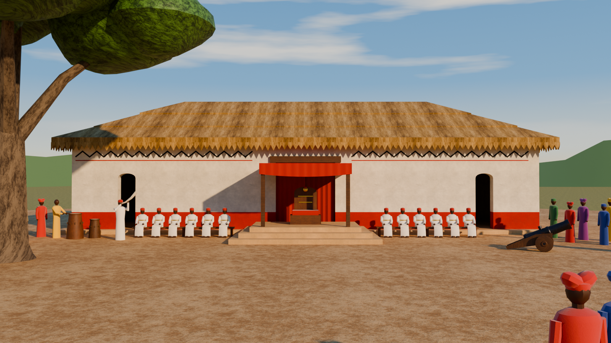

# Ofala (3D)

A game-ready Blender model of Ofala: stage 21, *the palace arena*. It is the Obi's palace at Onitsha on festival day, seen from its arena (*Ime Obi*):
- a long limewashed palace with a red dado, a black zigzag frieze and a great thatched hip roof;
- the empty throne under a red canopy on a three-step dais;
- the red-cap chiefs (*Ndichie*) on their benches;
- the royal drums and an ivory horn;
- the crowds, a salute cannon and a shade tree.

It is built from the 2D stage board and scaled for a 1.8 m player. As on the board, no real person is depicted. The throne stands empty, and the figures are generic and faceless.



## Files

| File | What it is |
|---|---|
| `Ofala.blend` | The model, saved with Blender 4.5 LTS. It also opens in Blender 5.x. Textures load from `Textures/` by relative path. |
| `build_ofala.py` | The script that generates the model: textures, meshes, UVs, materials, markers, preview rig and renders. It uses the mesh, UV, texture and material toolkit in `../stormshrine/build_stormshrine.py`. |
| `Textures/` | 31 tileable PNG maps: base colour, roughness and normal (OpenGL, green up) for each textured material. The plaster has three base colours (white wall, red dado, tan platform); the cloth shares one weave normal and roughness map. |
| `Renders/` | Preview renders: [front](Renders/Ofala_Front.png), [side](Renders/Ofala_Side.png), [three-quarter](Renders/Ofala_ThreeQuarter.png), [three-quarter from the back](Renders/Ofala_ThreeQuarter_Back.png), [player scale](Renders/Ofala_PlayerScale.png), [throne detail](Renders/Ofala_Detail_Throne.png) and a [plan](Renders/Ofala_Plan.png). The plan shows the trigger volumes (green), spawns (blue), VFX points (yellow) and sound points (pink). |
| `viewer/` | A 360° viewer page, its asset script and its assets. See [360° viewer](#360-viewer). |

## What was built

39,197 triangles in total, against a budget of 50k. All the meshes are parented to the empty `Ofala`, in six collections: `Ofala_Architecture`, `_Props`, `_Figures`, `_Landmarks`, `_Terrain` and `_Markers`.

| Object | Triangles | Notes |
|---|---:|---|
| `Ofala_Base` | 66 | Plastered platform, 0.20 m high, with a 0.60 m apron round the walls |
| `Ofala_Walls` | 346 | 0.45 m limewashed walls with a 0.82 m red dado, two arched side doors and the great doorway |
| `Ofala_Roof` | 1,176 | Thatched hip roof with equal pitch on all four sides, in three stepped courses at the board's two course lines; soffit and flat ceiling inside |
| `Ofala_RoofFringe` | 3,132 | The sawtooth thatch fringe along the eave, 0.32 m deep |
| `Ofala_WallPaint` | 1,060 | Black zigzag frieze and red line under the eave, in low relief, on all four walls |
| `Ofala_DoorLintel` | 12 | Dark wooden lintel over the great doorway |
| `Ofala_DoorCurtains` | 1,392 | The closed red curtains in the great doorway, folded. It is a separate object so a game can draw the curtains or turn off their collision. |
| `Ofala_Dais` | 28 | Three 0.20 m tiers in front of the great doorway |
| `Ofala_Throne` | 284 | The empty throne: seat, red cushion, rounded back with a gold knob and two gold bands |
| `Ofala_Canopy` | 2,020 | Two posts, a frame back to the wall, a red cloth roof, side valances and the front valance that hangs lowest in the middle |
| `Ofala_Benches` | 120 | Two wooden benches for the chiefs |
| `Ofala_Drums` | 804 | Two royal drums with hide heads and tuning pegs |
| `Ofala_Cannon` | 1,232 | Iron muzzle-loader on a wooden carriage, raised 24° for the salute |
| `Ofala_Chiefs` | 8,880 | Twelve seated red-cap chiefs in white robes with gold bands |
| `Ofala_Musicians` | 1,120 | The drummer (yellow) and the horn player (white) with a curved ivory horn |
| `Ofala_Crowd` | 12,336 | 16 spectators at the palace corners and 4 near the camera, in head-ties (*gele*) and caps |
| `Ofala_ShadeTree` | 3,077 | Broad shade tree framing the left of the arena, 12.3 m tall |
| `Ofala_Arena` | 2,112 | Beaten-earth arena, flat at Z = 0 out to 34 m from its centre, then dry grass rolling out to 140 m |

**Markers** (collection `Ofala_Markers`):
- **Trigger volumes:** `TRG_Throne`, `TRG_GreatDoor`, `TRG_SideDoor_L`, `TRG_SideDoor_R`, `TRG_Interior` and `TRG_Cannon`. These are wireframe meshes that don't render.
- **Point empties:**
  - `SPAWN_P1` and `SPAWN_P2`: the board's fighter start positions, 2.95 m apart on the arena, each facing along its own +Y.
  - `VFX_CannonSmoke`, at the muzzle.
  - `VFX_Dust_L` and `VFX_Dust_R`: cube empties whose scale gives the volume.
  - `SFX_Drums`, `SFX_Horn`, `SFX_Crowd_L`, `SFX_Crowd_R` and `SFX_Cannon`.

**Conventions:**
- **Units and axes:** 1 unit = 1 m, +Z up, and the palace faces −Y (Blender's front view).
- **Origin and transforms:** every mesh has identity transforms and shares the origin (0, 0, 0), the centre of the palace footprint at ground level.
- **UV maps:**
  - `UVMap` is in metres, so tiling materials scale it by 1 / tile size. Tile sizes: plaster and thatch 2 m; arena earth 4 m; grass 6 m; leaves 2 m; bark 1.5 m; wood and iron 1 m; cloth 0.5 m.
  - `UVLightmap` is the same islands packed into 0–1.
- **Not part of the asset:** the `Preview_Rig` collection (sky, sun, far hills, cameras) and `REF_PlayerScale` (1.8 m mannequins and labels).

## Player scale

| | |
|---|---|
| Side doors | 0.85 m wide, 2.45 m to the springing, 2.68 m at the arch, above the 0.20 m floor |
| Great doorway | 2.86 m wide and 3.26 m high; the canopy's wall beam crosses it at 2.93 m. Its curtains are drawn closed. |
| Floor | Platform and hall floor at 0.20 m, one 0.20 m step up from the arena |
| Dais | Three 0.20 m steps with 0.45 m treads; top tier 4.62 × 3.00 m at 0.60 m |
| Throne and canopy | Throne back 1.65 m above the dais. The valance clears 2.10 m above the dais in the middle and 2.21 m at the ends. |
| Palace | Walls 22.44 × 8.84 m outside and 4.22 m high; hall 21.54 × 7.94 m; eave 4.28 m and ridge 6.97 m above the ground; roof 23.8 × 10.2 m at the eave |
| Others | Benches 4.59 m long with the seat at 0.42 m; drums 1.10 and 0.83 m; cannon barrel 1.72 m; tree 12.3 m |

## Design choices (not from the board)

- **Scale.** The board has no absolute scale. At 0.017 m per SVG px the seated chiefs come out life-size, 1.07 m from the bench to the top of the cap. The side doors then come out at 0.85 × 2.68 m. Walls, roof, eave, doors, dais, throne, canopy, benches and frieze all come from the SVG at that scale.
- **Hidden sides.** Only the front is drawn. The roof's hip ends run 300 px across the board, so with equal pitch on all four sides the eave is 10.2 m deep and the walls 8.84 m. The side and back walls carry the same frieze and red line.
- **Platform.** A 0.20 m platform is added under the palace. The dais's first tier is level with it.
- **Dais depth.** The tiers' widths are the board's. Their depths (3.9, 3.45 and 3.0 m) are chosen so each tread is 0.45 m deep.
- **Canopy.** The board's valance hangs to 1.56 m above the dais, which would hit a standing player's head. The canopy is raised 0.31 m and its valance shortened, so its lowest edge clears 2.10 m and the throne can be reached. Its frame and cloth roof run back to the wall over the throne.
- **Great doorway.** Its curtains stay closed, as on the board, and the hall behind is empty, with a trigger volume. The side doors are open.
- **People.** The figures are stylized and faceless and stand in for the board's people, in their colours. They are kept in their own collection so a game can replace them. The crowds stand at the palace corners facing the arena, and four spectators stand near the camera, as at the board's bottom right.
- **Placement in depth.** The board is a side view. Depth positions keep its left-to-right order and front-to-back layering. The shade tree stands at the arena's front left so it frames the front view as on the board. The cannon stands in front of the right side door, where the board has it. The board's start positions are 656 px apart where a fighter is 400 px tall, so the spawns are 2.95 m apart, 8.6 m in front of the palace.
- **Cannon smoke and dust.** The board's smoke and dust are effects, so they are VFX markers rather than geometry.
- **Textures.** The repo has no textures, so all of them are generated by the script in the board's palette. Only the cannon's iron and the gold fittings are metallic.
- **Preview lighting.** The sky, the late-afternoon sun from the front right, the clouds and the far hills are only for the previews.

## Based on

- `2d-threejs/stages/Stage21-Ofala.html`: the SVG board. Every shape, position and colour comes from here.
- `2d-threejs/stages/previews/Stage21-Ofala.png`: the board as rendered, for comparison.
- `2d-threejs/stages/README.md`: stage 21's research basis (the Ofala festival at Onitsha, the red-cap chiefs, the royal drums, the cannon salute) and the shared stage spec (fighter height, start positions).
- `locations/stormshrine/build_stormshrine.py`: the shared toolkit and conventions.

## Rebuild

Run from the repo root. The first command rebuilds the model and textures; the second also renders the previews.

```bash
blender -b --factory-startup -P locations/ofala/build_ofala.py
```

```bash
blender -b --factory-startup -P locations/ofala/build_ofala.py -- --render all
```

`--out DIR`, `--samples N`, `--res WxH`, `--skip-textures` and `--debug-normals` are described at the top of the script.

## 360° viewer

`viewer/index.html` shows Ofala in a browser in two modes:
- **360° view:** look around from the fighters' start line in the arena, or from the dais in front of the throne. Both are 4096 × 2048 Cycles panoramas at 1.65 m eye height.
- **Orbit model:** the real-time model in the afternoon sun, with camera presets, a list that flies the camera to each feature, and a cannon salute with drifting arena dust. Ofala opens with a 21-gun salute, and the page counts the guns.

The page loads three.js and its fonts from the web, and its pictures and model from files next to it. Browsers block those files on a page opened straight from disk, so serve the folder:

```bash
cd locations/ofala/viewer && python3 -m http.server
```

Then open http://localhost:8000.

`make_viewer_assets.py` regenerates the panoramas, the sky and the web model (`ofala.json` and `tex/`) from `Ofala.blend`. The web model also carries the sun direction and the marker points the page uses. The panoramas take about 30 minutes on four CPU cores; `--skip-panoramas` keeps the existing ones.

```bash
blender -b locations/ofala/Ofala.blend -P locations/ofala/viewer/make_viewer_assets.py
```

## Checks

- **UVs:** no overlaps on either UV map of any mesh, tested triangle by triangle.
- **Overlapping faces:** none. Every pair of triangles within 1 mm of the same plane, across all meshes, was tested for overlap.
- **Normals:** winding is consistent on every mesh, and every closed mesh has positive volume. A back-face render from four views showed no faces seen from behind.
- **Ray tests on the saved file:**
  - Both side doors are clear to 2.3 m above the floor across their middle 0.6 m, through to the back wall of the hall.
  - Behind its curtains, the great doorway is clear to the back wall up to 2.8 m above the floor. The canopy's wall beam crosses it at 2.93 m.
  - Headroom is 2.67 m in the side doors, 3.25 m in the great doorway and 4.21 m in the hall.
  - The floor is at 0.20 m on the apron and in the hall, and at 0.20, 0.40 and 0.60 m on the dais tiers.
  - The approach to the left side door is open. The cannon stands in the straight line to the right door, 6 m out in the arena, so that approach goes round it.
- **Blender versions:** the script runs in Blender 4.5.15 LTS (where the file was saved) and 5.2.3 LTS, with the same triangle count and byte-identical textures.
- **glTF export:** it exports cleanly. The viewer's model is that export.
