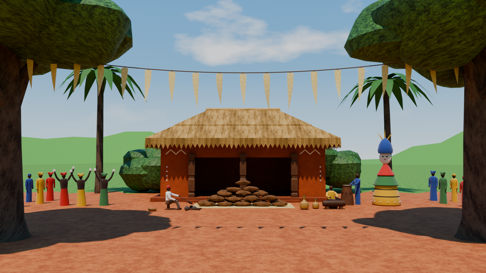

# New Yam festival (3D)

A game-ready Blender model of stage 25, *the New Yam festival* (*Iri ji*). It is a village arena on the day of the festival, bright and green at the end of the rainy season, and contains:
- an elder's thatched house with an open bay and carved posts;
- a great heap of new yams on a raffia mat;
- the elder in a red cap, roasting the first yam on a small fire, with a bowl of palm oil and gourds of palm wine nearby;
- women dancing with white cloths, drummers and a daytime masquerade;
- villagers at the edges;
- a string of young palm fronds hung between two big shade trees.

It is built from the 2D stage board and scaled for a 1.8 m player. The figures are generic and faceless; no real person is depicted.



## Files

| File | What it is |
|---|---|
| `NewYam.blend` | The model, saved with Blender 4.5 LTS. It also opens in Blender 5.x. Textures load from `Textures/` by relative path. |
| `build_newyam.py` | The script that generates the model: textures, meshes, UVs, materials, markers, preview rig and renders. It uses the mesh, UV, texture and material toolkit in `../stormshrine/build_stormshrine.py`. |
| `Textures/` | 45 tileable PNG maps: base colour, roughness and normal (OpenGL, green up) for each textured material, plus an emissive map for the embers. The earth plaster has two base colours (wall and plinth), the thatch two (roof and ridge straw) and the palm leaflets two (pale young fronds and green palm leaves). The cloth shares one weave normal and roughness map. |
| `Renders/` | Preview renders: [front](Renders/NewYam_Front.png), [side](Renders/NewYam_Side.png), [three-quarter](Renders/NewYam_ThreeQuarter.png), [three-quarter from the back](Renders/NewYam_ThreeQuarter_Back.png), [player scale](Renders/NewYam_PlayerScale.png), [the first yam](Renders/NewYam_Detail_FirstYam.png) and a [plan](Renders/NewYam_Plan.png). The plan shows the trigger volumes (green), spawns (blue), VFX points (yellow) and sound points (pink). |
| `viewer/` | A 360° viewer page, its asset script and its assets. See [360° viewer](#360-viewer). |

## What was built

35,292 triangles in total, against a budget of 50k. All the meshes are parented to the empty `NewYam`, in six collections: `NewYam_Architecture`, `_Props`, `_Figures`, `_Landmarks`, `_Terrain` and `_Markers`.

| Object | Triangles | Notes |
|---|---:|---|
| `NewYam_Base`, `NewYam_Step` | 66 / 8 | Earth plinth 0.25 m high with a 0.50 m apron, and a half-height step in front of the bay |
| `NewYam_Walls` | 50 | 0.40 m red-brown earth walls with the wide open bay in the front |
| `NewYam_Posts` | 372 | Three square hardwood posts in the bay, with carved bands and a wider capital |
| `NewYam_Roof` | 768 | Thatched hip roof with equal pitch on all four sides, in two stepped courses, with a pale straw roll along the ridge; soffit and flat ceiling inside |
| `NewYam_RoofFringe` | 1,644 | The sawtooth thatch fringe along the eave, 0.36 m deep |
| `NewYam_WallPaint` | 1,064 | White kaolin zigzags and columns of dots in low relief, on all four walls |
| `NewYam_YamHeap` | 4,428 | 41 new yams, 0.78 to 0.96 m long, in a five-layer pile 1.37 m high, with rows of 5, 4, 3, 2 and 1 on its front face as on the board |
| `NewYam_Mat` | 10 | The raffia mat under the heap, 5.3 × 2.3 m |
| `NewYam_Hearth` | 716 | Three hearth stones, a bed of embers and four sticks, and the elder's carved stool |
| `NewYam_Vessels` | 720 | A calabash of red palm oil and two gourds of palm wine stoppered with leaves |
| `NewYam_Drums` | 750 | A tall standing drum with a hide head and tuning pegs, and a slit drum (*ekwe*) on two blocks with the second drummer's stool |
| `NewYam_Elder` | 784 | The elder in a red cap and white top, seated, holding the first yam over the fire on a stick |
| `NewYam_Dancers` | 2,328 | Three women in red, yellow and green wrappers and head-ties, arms raised with white cloths |
| `NewYam_Drummers` | 1,060 | The drummer in blue at the tall drum and a seated second drummer striking the slit drum |
| `NewYam_Masquerade` | 1,618 | The daytime masquerade: yellow skirt banded in black with white beads, green cape, red top, white face mask, blue crest and three yellow spikes, 4.15 m tall |
| `NewYam_Villagers` | 7,360 | Twelve villagers at the two edges of the arena, in head-ties and caps |
| `NewYam_Trees` | 5,834 | The two shade trees framing the arena, 9.8 m tall with low crowns |
| `NewYam_Palms` | 1,152 | Two oil palms behind the house, 9.4 m tall |
| `NewYam_Bushes` | 1,680 | The two bush clumps behind the house |
| `NewYam_FrondString` | 896 | A rope between the two trees with 19 pale young palm fronds (*omu*), 1.0 to 1.25 m long |
| `NewYam_Arena` | 1,984 | Swept red laterite, flat at Z = 0 out to 26 m from the arena centre, with lush grass behind the house and beyond, rolling out to 140 m |

**Markers** (collection `NewYam_Markers`):
- **Trigger volumes:** `TRG_Bay`, `TRG_Interior`, `TRG_YamHeap`, `TRG_FirstYam` (the elder and the fire) and `TRG_Masquerade`. These are wireframe meshes that don't render.
- **Point empties:**
  - `SPAWN_P1` and `SPAWN_P2`: the board's fighter start positions, 2.95 m apart on the arena, each facing along its own +Y.
  - `VFX_FireSmoke` and `VFX_FireEmbers`, at the fire.
  - `VFX_Dust` and `VFX_FrondSway`: cube empties whose scale gives the volume (arena dust, and the breeze in the young fronds).
  - `SFX_Drums`, `SFX_Ekwe`, `SFX_Dancers`, `SFX_Masquerade`, `SFX_Fire`, `SFX_Crowd_L` and `SFX_Crowd_R`.

**Conventions:**
- **Units and axes:** 1 unit = 1 m, +Z up, and the house faces −Y (Blender's front view).
- **Origin and transforms:** every mesh has identity transforms and shares the origin (0, 0, 0), the centre of the house footprint at ground level.
- **UV maps:**
  - `UVMap` is in metres, so tiling materials scale it by 1 / tile size. Tile sizes: plaster and thatch 2 m; laterite 4 m; grass 6 m; leaves 2 m; bark 1.5 m; wood, raffia and palm leaflets 1 m; stone 0.6 m; yam skin, embers and cloth 0.5 m.
  - `UVLightmap` is the same islands packed into 0–1.
- **Not part of the asset:** the `Preview_Rig` collection (sky, sun, far hills, cameras) and `REF_PlayerScale` (1.8 m mannequins and labels).

## Player scale

| | |
|---|---|
| Open bay | 6.08 m wide and 2.36 m high, split by the three posts into two openings 2.66 m wide |
| Floor | Plinth and hall floor at 0.25 m, reached by one 0.125 m step (0.40 m tread, 6.6 m wide) |
| House | Walls 9.88 × 5.32 m outside and 3.42 m high; hall 9.08 × 4.52 m; eave 3.48 m and ridge 5.84 m above the ground; roof 11.4 × 6.84 m at the eave, pitched about 32° |
| Yam heap | 4.8 × 1.3 m and 1.37 m high, on a 5.3 × 2.3 m mat, with a 0.9 m gap between the heap and the step |
| Others | Elder's stool 0.32 m; drum 1.07 m; slit drum 1.1 m long; masquerade 4.15 m; frond string 6.0 m at the trees, sagging to 5.3 m |

## Design choices (not from the board)

- **Scale.** The board has no absolute scale. At 0.019 m per SVG px the dancers and the drummer, drawn 88 px from the feet to the crown, come out 1.67 m tall. The house's bay then comes out at 2.36 m high. Walls, roof, eave, bay, posts, kaolin motifs, mat, fire, vessels and masquerade all come from the SVG at that scale.
- **Hidden sides.** Only the front is drawn. The roof's hip ends run 180 px across the board, so with equal pitch on all four sides the eave is 6.84 m deep and the walls 5.32 m. The side and back walls repeat the kaolin zigzags and dots.
- **Plinth and step.** A 0.25 m earth plinth and a half-height step in front of the bay are added.
- **Open bay.** The board's dark opening with three posts is read as an open bay into the house. The hall behind is empty, with a trigger volume.
- **Yam heap.** At this scale the board's 15 yams would each be about 1 m long and the heap 1.8 m high. The model uses 41 large yams in a five-layer pile 1.37 m high instead. It keeps the board's 5-4-3-2-1 rows on its front face.
- **The first yam.** The elder sits on a low stool facing the fire and holds the yam over three hearth stones on a stick. The smoke is a VFX marker.
- **Second drummer.** The board's description has drummers, but only one is drawn, so a second drummer with an *ekwe* (slit drum) is added.
- **People.** The figures are stylized and faceless and stand in for the board's people, in their colours. They are kept in their own collection so a game can replace them. The masquerade is half turned toward the arena.
- **Trees and the frond string.** The board's two foreground trees stand at the arena's front corners, with crowns low enough to fill the front view's top corners. The frond string ties onto their trunks at 6.0 m and sags 0.7 m.
- **Placement in depth.** The board is a side view. Depth positions keep its left-to-right order and front-to-back layering. Figures in front of the house are drawn in toward the centre line by 0.92, so the front view keeps the board's composition. The board's start positions are 656 px apart where a fighter is 400 px tall, so the spawns are 2.95 m apart, 7.3 m in front of the yam heap.
- **Sun.** The preview sun is high (67°) and a little to the front left, as near midday in August, so the trees' shade falls on the arena rather than on the yams.
- **Textures.** The repo has no textures, so all of them are generated by the script in the board's palette. Nothing is metallic.
- **Preview lighting.** The sky, sun, clouds and far hills are only for the previews.

## Based on

- `stages/Stage25-NewYam.html`: the SVG board. Every shape, position and colour comes from here.
- `previews/Stage25-NewYam.png`: the board as rendered, for comparison.
- `docs/fighting-stages.md`: stage 25's research basis (the festival at the end of the rains, the first yam eaten by an elder with palm oil, dances and masquerades) and the shared stage spec (fighter height, start positions).
- `stormshrine/build_stormshrine.py`: the shared toolkit and conventions. The figure, roof, wall and drum builders follow `ofala/build_ofala.py`.

## Rebuild

Run from the repo root. The first command rebuilds the model and textures; the second also renders the previews.

```bash
blender -b --factory-startup -P newyam/build_newyam.py
```

```bash
blender -b --factory-startup -P newyam/build_newyam.py -- --render all
```

`--out DIR`, `--samples N`, `--res WxH`, `--skip-textures` and `--debug-normals` are described at the top of the script.

## 360° viewer

`viewer/index.html` shows the New Yam festival in a browser in two modes:
- **360° view:** look around from the fighters' start line in the arena, or from the elder's open bay looking out over the yams. Both are 4096 × 2048 Cycles panoramas at 1.65 m eye height.
- **Orbit model:** the real-time model in the midday sun, with camera presets and a list that flies the camera to each feature. With *Dances and smoke* on, the masquerade turns and sways, the dancers bounce, the young fronds swing in the breeze and the first yam's fire smokes.

The page loads three.js and its fonts from the web, and its pictures and model from files next to it. Browsers block those files on a page opened straight from disk, so serve the folder:

```bash
cd newyam/viewer && python3 -m http.server
```

Then open http://localhost:8000.

`make_viewer_assets.py` regenerates the panoramas, the sky and the web model (`newyam.json` and `tex/`) from `NewYam.blend`. The web model also carries the sun direction and the marker points the page uses. The panoramas take about 30 minutes on four CPU cores; `--skip-panoramas` keeps the existing ones.

```bash
blender -b newyam/NewYam.blend -P newyam/viewer/make_viewer_assets.py
```

## Checks

- **UVs:** no overlaps on either UV map of any mesh, tested triangle by triangle.
- **Overlapping faces:** none. Every pair of triangles within 1 mm of the same plane, across all meshes, was tested for overlap.
- **Normals:** winding is consistent on every mesh, and every closed mesh has positive volume. A back-face render from four views showed no faces seen from behind.
- **Ray tests on the saved file:**
  - Both openings of the bay are clear through to the back wall of the hall up to 2.2 m above the floor, between and beside the posts.
  - Headroom is 2.35 m in the bay and 3.41 m in the hall.
  - The floor is at 0.125 m on the step and 0.25 m on the apron and in the hall.
  - Two routes from the arena to the step are open: up the left side and along the front of the heap, or round the masquerade's far side and back along the front of the house.
- **Blender versions:** the script runs in Blender 4.5.15 LTS (where the file was saved) and 5.2.3 LTS, with the same triangle count and byte-identical textures.
- **glTF export:** it exports cleanly. The viewer's model is that export.
