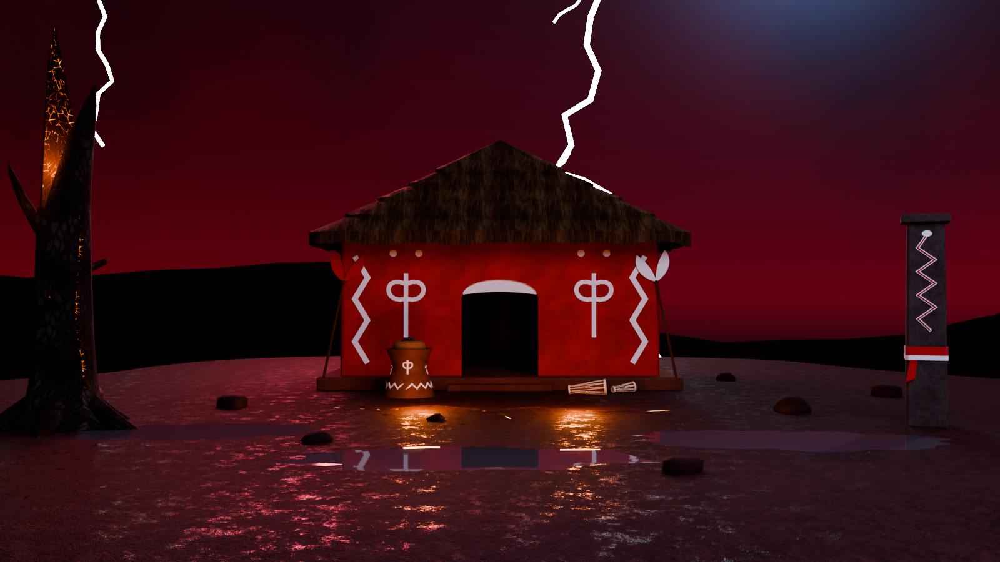

# Stormshrine (3D)

A game-ready Blender model of the Stormshrine: stage 11, *Ṣàngó's storm hill*. It is Ṣàngó's red mud shrine house on a wet hilltop in a night thunderstorm, with the carved mortar altar (*odó Ṣàngó*) and its thunder-stones, *oṣé* staffs, *bàtá* drums, a glowing lightning scar, the split smouldering tree and the carved snake pillar. It is built from the 2D stage board and scaled for a 1.8 m player.



## Files

| File | What it is |
|---|---|
| `Stormshrine.blend` | The model, saved with Blender 4.5 LTS. It also opens in Blender 5.x. Textures load from `Textures/` by relative path. |
| `build_stormshrine.py` | The script that generates the model: textures, meshes, UVs, materials, markers, preview rig and renders. |
| `Textures/` | 29 tileable PNG maps: base colour, roughness and normal (OpenGL, green up) for each textured material, plus emissive maps for the ember and the lightning scar. |
| `Renders/` | Preview renders: [front](Renders/Stormshrine_Front.png), [side](Renders/Stormshrine_Side.png), [three-quarter](Renders/Stormshrine_ThreeQuarter.png), [three-quarter from the back](Renders/Stormshrine_ThreeQuarter_Back.png), [player scale](Renders/Stormshrine_PlayerScale.png), [altar detail](Renders/Stormshrine_Detail_Altar.png) and a [plan](Renders/Stormshrine_Plan.png) that shows the trigger volumes (green), spawns (blue), VFX points (yellow) and the drum sound point (pink). |
| `viewer/` | A 360° viewer page, its asset script and its assets. See [360° viewer](#360-viewer). |

## What was built

17,630 triangles in total, against a budget of 50k. All the meshes are parented to the empty `Stormshrine`.

| Object | Triangles | Notes |
|---|---:|---|
| `Stormshrine_Base` | 106 | Earthen platform, 0.30 m high, with one 0.15 m step at the door |
| `Stormshrine_Walls` | 168 | 0.40 m mud walls with an arched door; red plaster outside, earth plaster inside, whitewashed arch underside |
| `Stormshrine_DoorValance` | 104 | White cloth hung under the arch |
| `Stormshrine_Roof` | 1,584 | Thatch whose four slopes meet at one apex, in five stepped courses with a ragged eave; flat mud ceiling inside |
| `Stormshrine_WallMotifs` | 1,644 | White kaolin paint in low relief: lightning zigzags, *oṣé* emblems and dots |
| `Stormshrine_Altar` | 2,140 | *Odó Ṣàngó* with white reliefs: *oṣé* front and back, a zigzag snake round the foot, a dog on each flank |
| `Stormshrine_AltarBowl` | 1,088 | Calabash bowl sitting in the mortar top |
| `Stormshrine_Thunderstones` | 600 | Six polished stone celts (*edun ara*) heaped in the bowl |
| `Stormshrine_OseStaff_Red`, `_White` | 276 each | Double-axe staffs leaning on the front corners |
| `Stormshrine_BataDrum_Iya`, `_Omele` | 2,124 / 1,748 | Conical drums with rawhide heads, zigzag thongs and red and white beads |
| `Stormshrine_SnakePillar` | 304 | Carved stone pillar with a red snake outlined in white, cloth bands and a hanging red tail |
| `Stormshrine_SplitTree` | 958 | Dead trunk split by lightning, with smouldering split faces and a glowing fissure |
| `Stormshrine_Hilltop` | 2,808 | Flat wet crown at Z = 0, falling away to a rough crest |
| `Stormshrine_LightningScar`, `_Puddles`, `_Rocks` | 730 / 252 / 720 | The glowing crack, rain pools and stones |

**Markers** (collection `Stormshrine_Markers`):
- **Trigger volumes:** `TRG_Doorway`, `TRG_Interior`, `TRG_Altar` and `TRG_Drums`. These are wireframe meshes that don't render.
- **Point empties:**
  - `SPAWN_P1` and `SPAWN_P2`: the board's fighter start positions, 2.95 m apart, each facing along its own +Y.
  - `VFX_LightningScar`, `VFX_ThunderstoneGlint`, `VFX_TreeEmbers` and `VFX_TrunkFissure`.
  - `VFX_LightningStrike_Far` and `VFX_LightningStrike_Left`.
  - `VFX_RainVolume`: a cube empty whose scale gives the volume.
  - `SFX_BataDrums`.

**Conventions:**
- **Units and axes:** 1 unit = 1 m, +Z up, and the house faces −Y (Blender's front view).
- **Origin and transforms:** every mesh has identity transforms and shares the origin (0, 0, 0), the centre of the house footprint at ground level.
- **UV maps:**
  - `UVMap` is in metres, so tiling materials scale it by 1 / tile size. Tile sizes: plaster, earth and thatch 2 m; ground 4 m; stone and bark 1.5 m; wood and ember 1 m. The scar's emissive core runs 0–1 across the crack.
  - `UVLightmap` is the same islands packed into 0–1.
- **Not part of the asset:** the `Preview_Rig` collection (sky, lights, far hills, lightning bolts, cameras) and `REF_PlayerScale` (1.8 m mannequins and labels).

## Player scale

| | |
|---|---|
| Door | 1.94 m wide, 2.00 m to the top of the jambs, 2.44 m at the arch; the valance's lower edge is at 2.05–2.12 m |
| Floor | Platform and room floor at 0.30 m, reached by one 0.15 m step (0.35 m tread, 2.6 m wide) |
| House | Walls 8.10 × 6.40 m outside and 3.56 m high; room 7.30 × 5.60 m; eave 3.65 m and apex 6.78 m above the ground |
| Altar | 1.10 m tall, 1.18 m across the foot; the bowl rim is at 1.29 m |
| Others | Staffs about 3.1 m, *iyá* drum 0.85 m, pillar 3.78 m, tree 7.25 m |

## Design choices (not from the board)

- **Scale.** The board has no absolute scale, and the house sits far back in it, too small to enter. The house is scaled from its door: the 74 px door jambs are set to 2.0 m, which gives 0.027 m per SVG px. Walls, roof, eave, door arch and motif positions all come from the SVG at that scale.
- **Prop sizes.** The board draws its foreground props oversized, so the props are sized for the player instead.
- **Hidden sides.** Only the front is drawn. The plan is 8.1 × 6.4 m, with roof slopes that meet at one apex so the front keeps the board's triangle. The side and back walls repeat the front's motifs.
- **Thatch.** The board draws the thatch as a flat triangle. The roof is built in stepped courses so it reads as thatch in 3D.
- **Platform and step.** These are added to give the house a raised floor and an entrance step.
- **White band under the arch.** It is modelled as a cloth valance, raised so its lower edge stays above 2.05 m and the door stays passable. The arch's underside is also whitewashed.
- **Red line along the roof edge.** It is the same red as the clouds' rim light, so it is treated as lighting, not geometry.
- **Second drum.** The board's description mentions "bàtá drums" but only one is drawn, so a smaller second drum is added.
- **Altar reliefs and stones.** The dogs and the second *oṣé* on the altar follow the research note (double-axe, dog and zigzag-snake reliefs); the board only shows the front. The thunder-stones are modelled as stone axe-heads, 14–19 cm long.
- **Depth layout.** The board is a side view. Depth positions keep its left-to-right order and front-to-back layering. The interior is not drawn, so it is left empty, with a trigger volume.
- **Oṣé blades.** The staff blades follow the board's V shape, made symmetric.
- **Textures.** The repo has no textures, so all of them are generated by the script in the board's palette. The design has no metal, so Metallic is 0 throughout.
- **Preview lighting.** The sky, lightning, far hills and lights are only for the previews, after the board's night storm.

## Based on

- `stages/Stage11-StormShrine.html`: the SVG board. Every shape, position and colour comes from here.
- `previews/Stage11-StormShrine.png`: the board as rendered, for comparison.
- `docs/fighting-stages.md`: stage 11's research basis (*odó Ṣàngó*, *edun ara*, the reliefs) and the shared stage spec (fighter height, start positions).
- `gods/orisa-and-alusi.html`: Ṣàngó's entry (red and white, the *oṣé*, *bàtá* drums).
- `stages/FightStage.html`: how the *oṣé* and the thunder-stone are drawn elsewhere in the game.

## Rebuild

Run from the repo root. The first command rebuilds the model and textures; the second also renders the previews.

```bash
blender -b --factory-startup -P stormshrine/build_stormshrine.py
```

```bash
blender -b --factory-startup -P stormshrine/build_stormshrine.py -- --render all
```

`--out DIR`, `--samples N`, `--res WxH`, `--skip-textures` and `--debug-normals` are described at the top of the script.

## 360° viewer

`viewer/index.html` shows the Stormshrine in a browser in two modes:
- **360° view:** look around from the hilltop floor 10 m in front of the door, or from just inside the doorway. Both are 4096 × 2048 Cycles panoramas at 1.65 m eye height.
- **Orbit model:** the real-time model, with storm lighting, rain, lightning flashes, camera presets, and a list that flies the camera to each feature.

The page loads three.js and its fonts from the web, and its pictures and model from files next to it. Browsers block those files on a page opened straight from disk, so serve the folder:

```bash
cd stormshrine/viewer && python3 -m http.server
```

Then open http://localhost:8000.

`make_viewer_assets.py` regenerates the panoramas, the sky and the web model (`stormshrine.json` and `tex/`) from `Stormshrine.blend`. The panoramas take about 20 minutes on four CPU cores; `--skip-panoramas` keeps the existing ones.

```bash
blender -b stormshrine/Stormshrine.blend -P stormshrine/viewer/make_viewer_assets.py
```

## Checks

- **UVs:** no overlaps on either UV map of any mesh, tested triangle by triangle.
- **Overlapping faces:** none. Every pair of triangles within 1 mm of the same plane, across all meshes, was tested for overlap. Hidden faces (undersides, wall tops under the roof) are removed, and relief strokes that cross stand at least 2 mm apart.
- **Normals:** winding is consistent on every mesh, and every closed mesh has positive volume. A back-face render from four views showed no faces seen from behind.
- **Ray tests on the saved file:**
  - The doorway is clear up to 2.0 m above the floor across its middle 0.9 m.
  - Headroom is 2.43 m in the doorway and 3.55 m in the room.
  - The approach to the step is open.
- **Blender versions:** the file opens in Blender 4.5.15 LTS (where it was saved) and 5.2.3 LTS, with all 29 textures found. The script runs in both and writes byte-identical textures.
- **glTF export:** it exports cleanly. Every material maps to the standard PBR slots (base colour, metallic-roughness, normal, emissive), and the tile sizes carry over as `KHR_texture_transform`.
